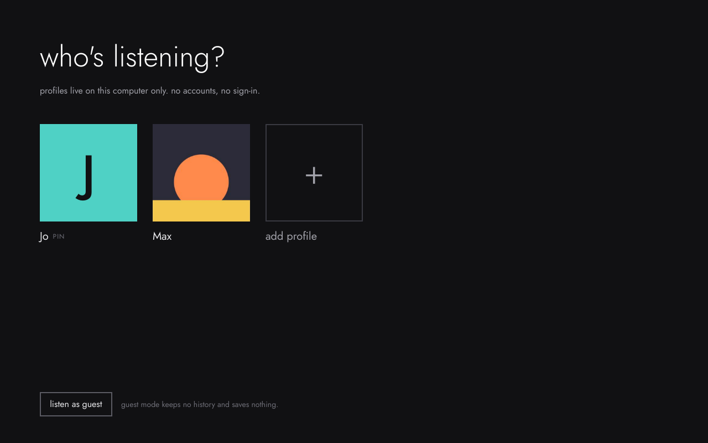
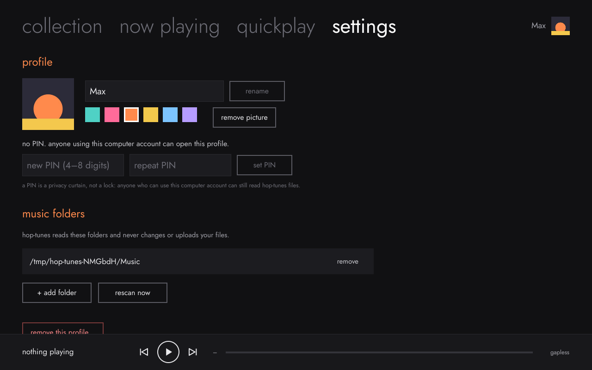
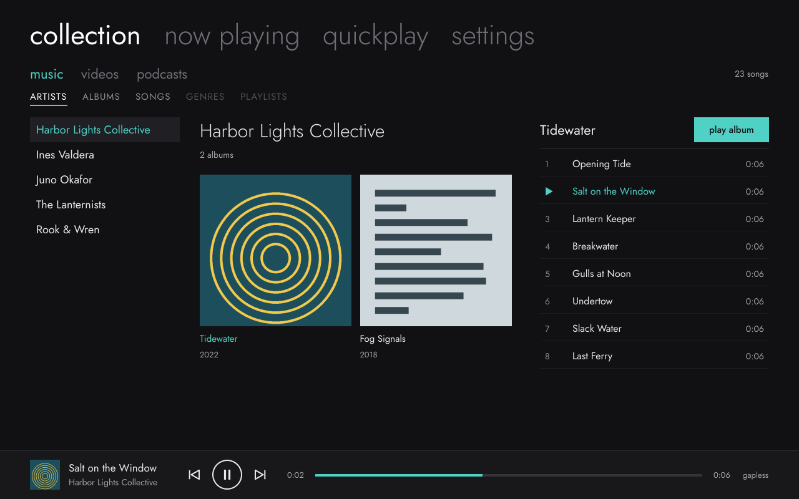
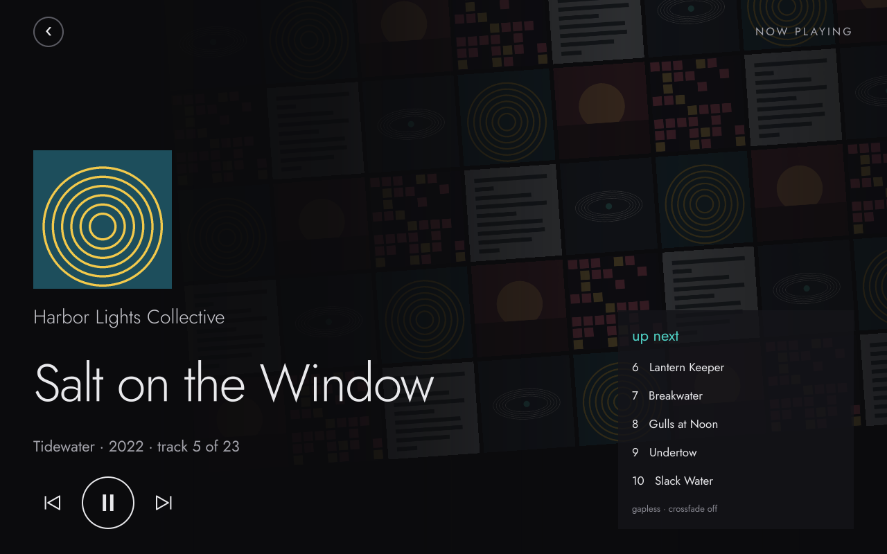

# **A local-first music player inspired by the Zune software**

**Hop-tunes** · Linux · GPL-3.0 · no accounts, no tracking

> [!WARNING]
> **In development: do not download.** Hop-tunes is unfinished and not ready for everyday use. Builds may change or break without notice, and there are no stable releases yet.

## Docs

- [`SPEC.md`](SPEC.md): product and technical spec: a local-first, login-free music player with local profiles.

- [`design/`](design/): screenshots of the real app for each milestone, plus the original design mockups.

## Status

- **M1 (play a folder): done.** Incremental library scan, gapless playback, song list, now playing, mini player.
- **M2 (collection): done** except search. Artists → albums → songs panes, albums grid, cover art (embedded + folder images), MPRIS media keys and desktop media widgets.
- **M3 (local profiles): done.** "Who's listening?" picker, first-run profile setup, optional PIN (a privacy curtain, not security), accent colour and picture per profile, switch without restarting, guest mode that saves nothing. Each profile has its own folders and settings. No accounts or sign-in.
- **AppImage:** portable build for glibc 2.35+ distros, tested on 10 distro/display setups; see [`packaging/appimage/`](packaging/appimage/).

**New in M3: local profiles**

| who's listening? | settings › profile |
|---|---|
|  |  |

**M1–M2: the music collection**

| collection › artists | now playing |
|---|---|
|  |  |

More renders, plus the original design targets, are in [`design/`](design/).

## Building

Hop-tunes is C++20 + Qt 6 (QML) + GStreamer + TagLib + SQLite.

**CachyOS / Arch**
```sh
sudo pacman -S --needed base-devel cmake ninja qt6-base qt6-declarative taglib sqlite \
    gstreamer gst-plugins-base gst-plugins-good gst-libav
```

**Ubuntu 24.04 / Debian**
```sh
sudo apt install cmake ninja-build g++ pkg-config qt6-base-dev qt6-declarative-dev \
    qml6-module-qtquick-controls qml6-module-qtquick-layouts qml6-module-qtquick-dialogs \
    qml6-module-qtquick-templates qml6-module-qtqml-workerscript \
    libtag1-dev libsqlite3-dev libgstreamer1.0-dev gstreamer1.0-plugins-good gstreamer1.0-libav
```

**Build, test, run**
```sh
cmake -S . -B build -G Ninja -DCMAKE_BUILD_TYPE=RelWithDebInfo
cmake --build build
ctest --test-dir build --output-on-failure
./build/hop-tunes
```

On first run Hop-tunes offers `~/Music`; add other folders under **settings**. Your data lives in `~/.local/share/hop-tunes/`.

## Research

- [`zune-teardown/`](zune-teardown/): structural teardown of the final Zune 4.8 software: installer format, component architecture, device and service map, and the open-source tools used to produce it. Groundwork for a clean-room implementation.
