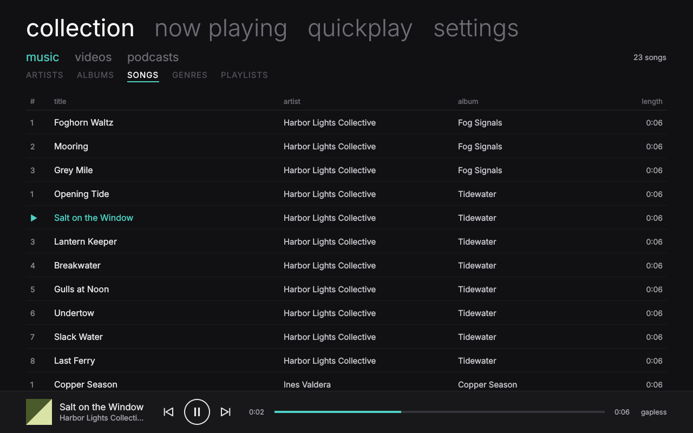
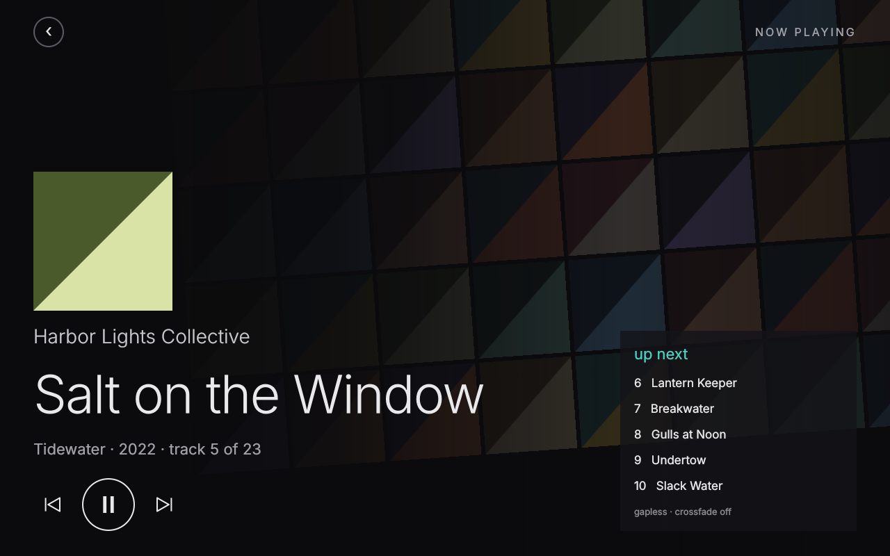
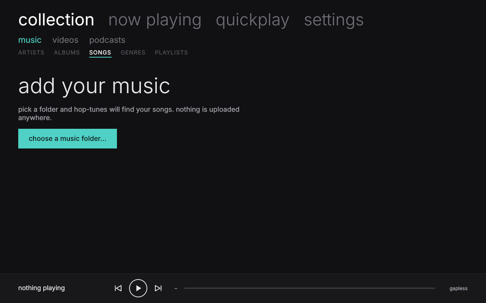
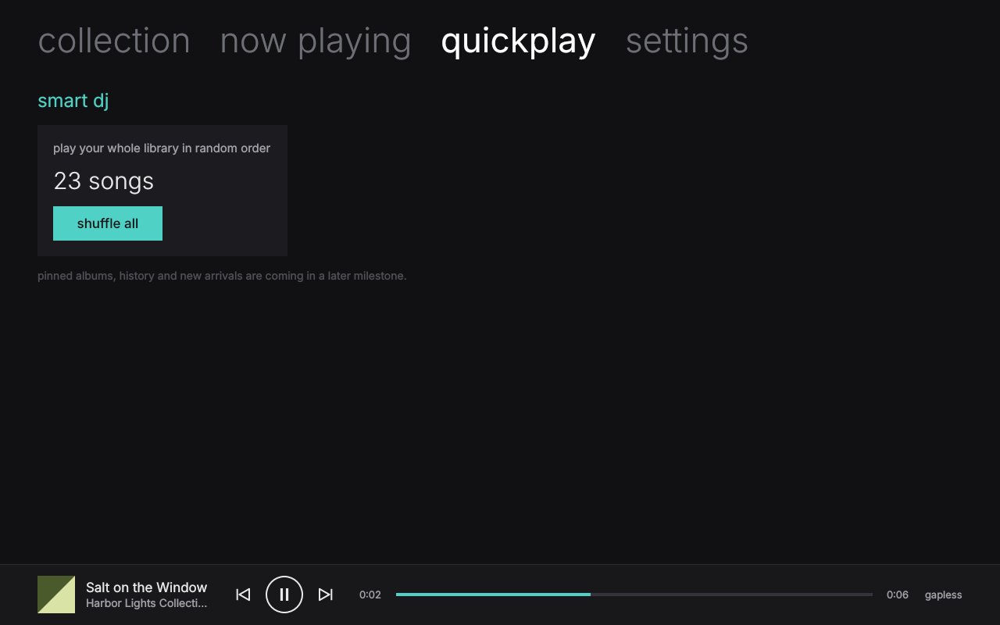

# Hop-tunes
An open source version of Microsoft Zune 

## Docs

- [`SPEC.md`](SPEC.md): product and technical spec: a local-first, login-free music player with local profiles.

- [`design/`](design/): reference mockups of the five core screens (PNG screenshots + clickable HTML pages) for building the real app's UI.

## Status

**M1 (play a folder) works:** library scan, gapless playback, collection song list, now playing, mini player. Real screenshots from the app (headless render):

| collection | now playing |
|---|---|
|  |  |
| **first run** | **quickplay** |
|  |  |

The design targets for later milestones are in [`design/`](design/).

## Building

Hop-tunes is C++20 + Qt 6 (QML) + GStreamer + TagLib + SQLite.

**CachyOS / Arch**
```sh
sudo pacman -S --needed base-devel cmake ninja qt6-base qt6-declarative taglib sqlite \
    gstreamer gst-plugins-base gst-plugins-good gst-libav
```

**Ubuntu 24.04 / Debian**
```sh
sudo apt install cmake ninja-build g++ pkg-config qt6-base-dev qt6-declarative-dev \
    qml6-module-qtquick-controls qml6-module-qtquick-layouts qml6-module-qtquick-dialogs \
    qml6-module-qtquick-templates qml6-module-qtqml-workerscript \
    libtag1-dev libsqlite3-dev libgstreamer1.0-dev gstreamer1.0-plugins-good gstreamer1.0-libav
```

**Build, test, run**
```sh
cmake -S . -B build -G Ninja -DCMAKE_BUILD_TYPE=RelWithDebInfo
cmake --build build
ctest --test-dir build --output-on-failure
./build/hop-tunes
```

On first run Hop-tunes offers `~/Music`; add other folders under **settings**. Your data lives in `~/.local/share/hop-tunes/`.

## Research

- [`zune-teardown/`](zune-teardown/): structural teardown of the final Zune 4.8 software: installer format, component architecture, device and service map, and the open-source tools used to produce it. Groundwork for a clean-room implementation.
