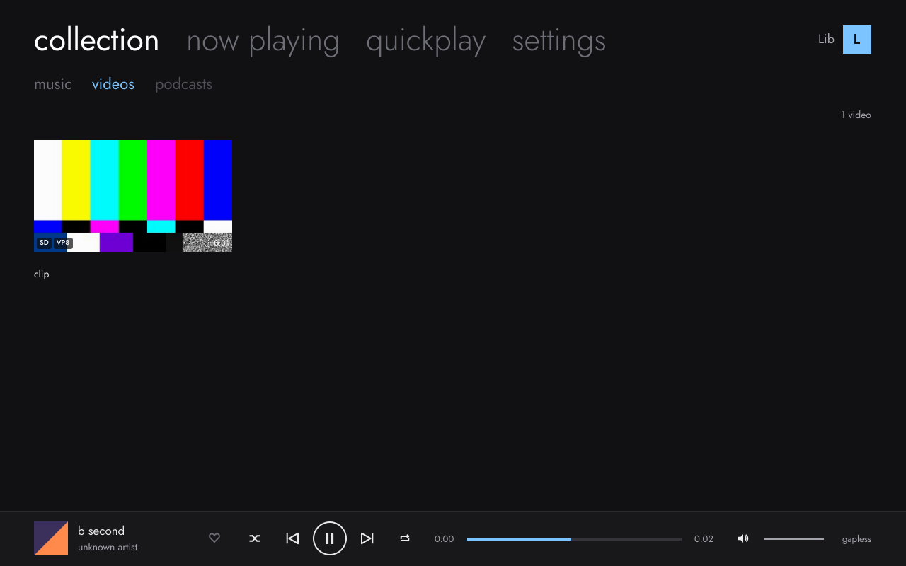
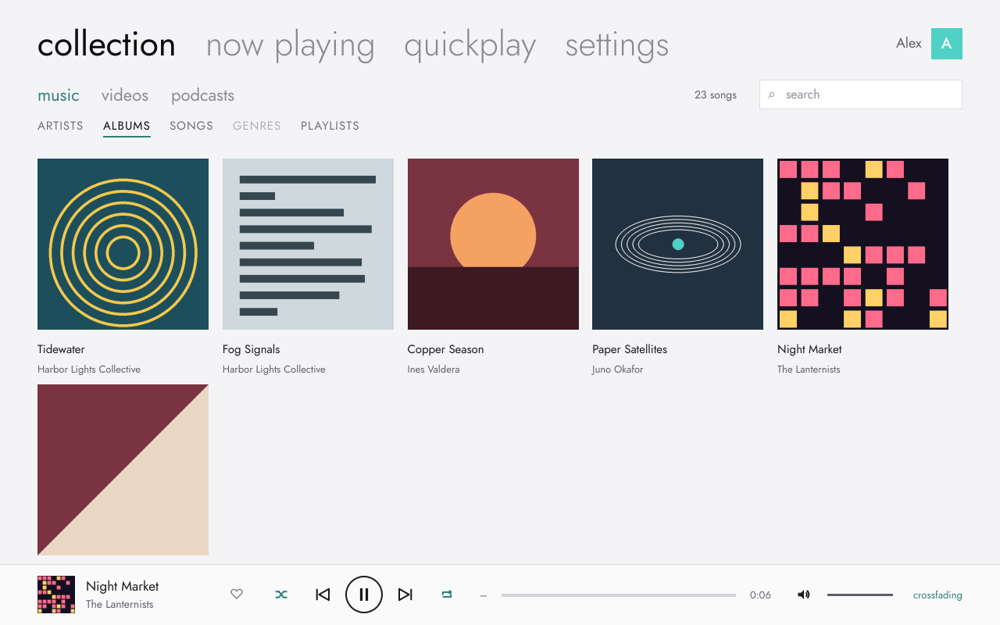
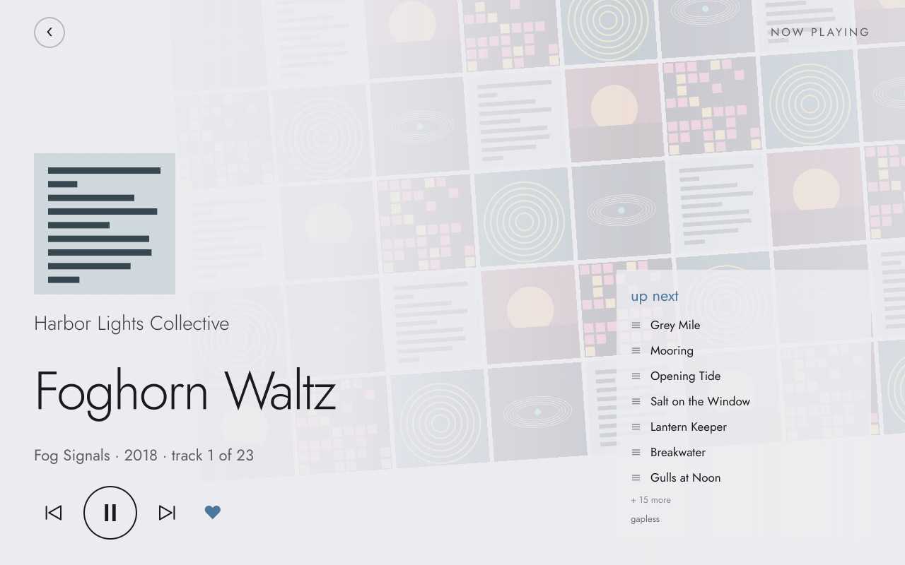
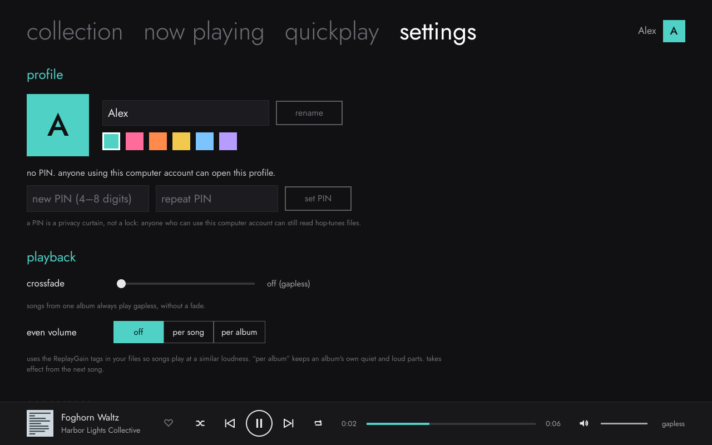
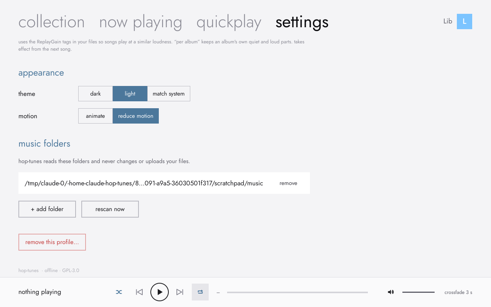
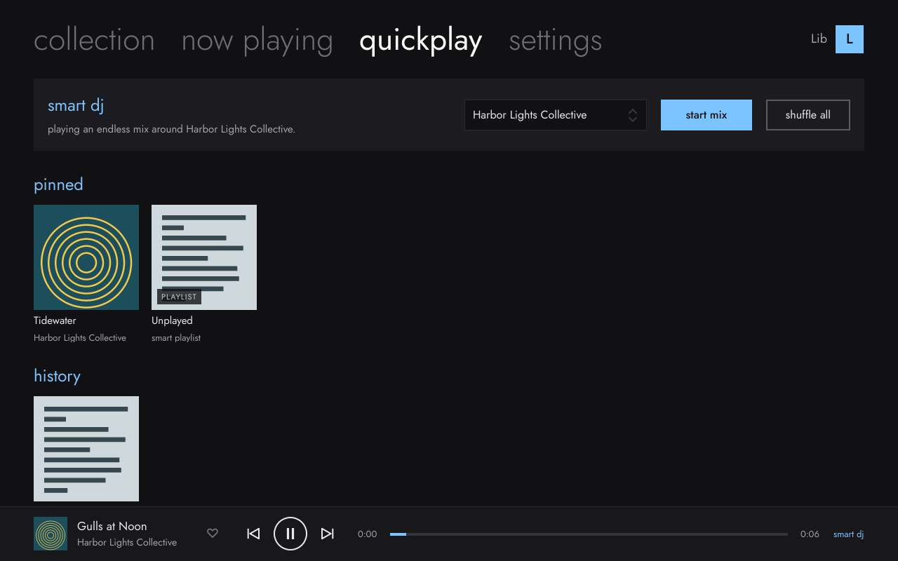
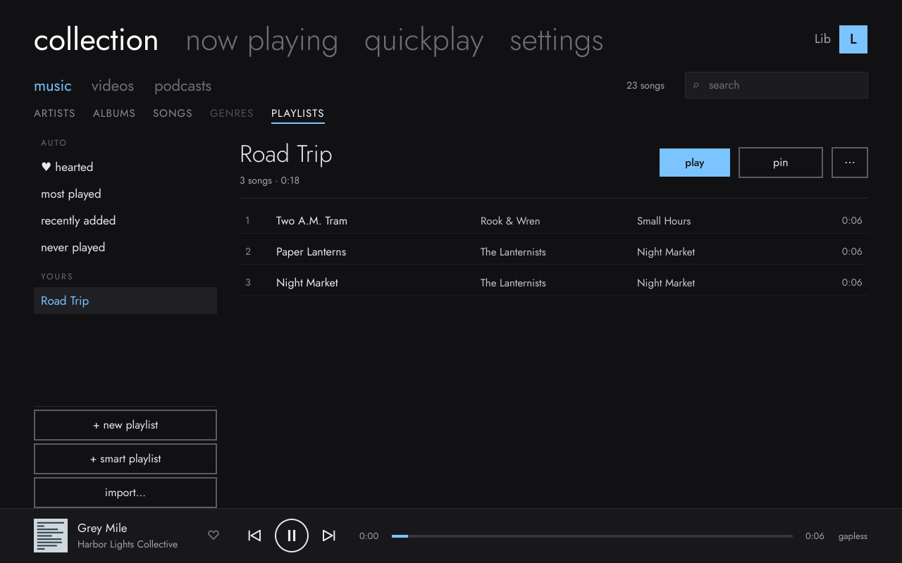
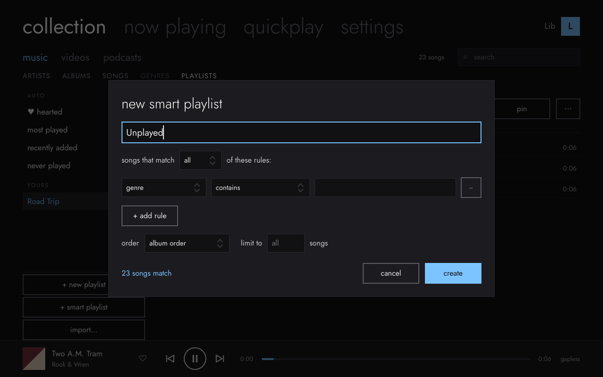
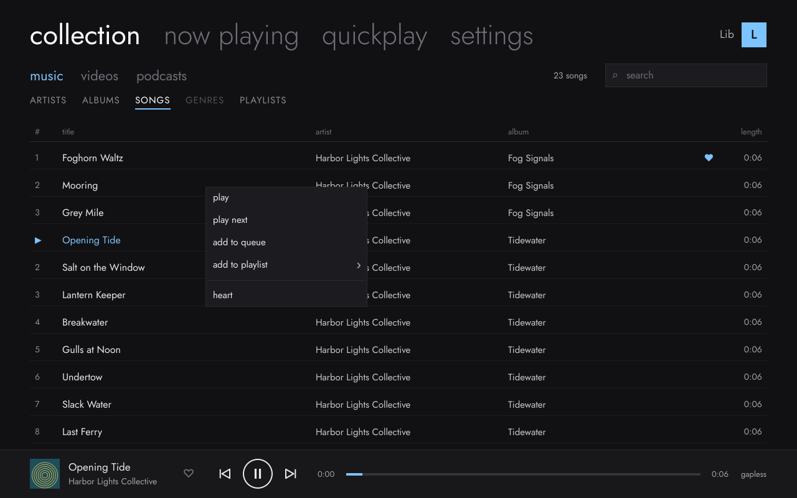

# **A local-first music player inspired by the Zune software**

*Missed the Zune software? This is for you.*

**Hop-tunes** · Linux · GPL-3.0 · no accounts, no tracking

> [!WARNING]
> **Feature complete. Download at your own risk.** Hop-tunes 1.2 includes every planned feature — M7 video playback included — and passes its automated test suite on 16 Linux distributions. The developer has now tested it on real hardware (a Steam Deck running CachyOS Handheld Edition, AppImage only) — that testing is what found and fixed a video-playback bug for this release. Other install methods and hardware are still untested by the developer, so if you choose to try it, you do so at your own risk.

## Install

| | |
|---|---|
| **Flatpak** | `Hop-tunes-x86_64.flatpak` from the [releases page](https://github.com/theStyleWithin/Hop-tunes/releases), then `flatpak install --user Hop-tunes-x86_64.flatpak` |
| **Arch / CachyOS (AUR)** | `yay -S hop-tunes` (or `hop-tunes-git` for the latest code) |
| **AppImage** | download, `chmod +x`, run. Any x86_64 distro from 2022 on |

**Tested on 16 distros, with CachyOS first.** See [which distros Hop-tunes runs on](docs/COMPATIBILITY.md). Distros older than 2022 may not work with the AppImage; use the Flatpak there.

The [user guide](docs/user-guide.md) covers everything from the first run to troubleshooting.

## Docs

- [`docs/user-guide.md`](docs/user-guide.md): how to use Hop-tunes.
- [`docs/COMPATIBILITY.md`](docs/COMPATIBILITY.md): tested distros (CachyOS first) and what to use on older ones.
- [`CHANGELOG.md`](CHANGELOG.md): what changed in each version.
- [`SPEC.md`](SPEC.md): product and technical spec: a local-first, login-free music player with local profiles.
- [`THIRD_PARTY_NOTICES.md`](THIRD_PARTY_NOTICES.md): open-source components and their licenses; trademark notice.
- [`packaging/`](packaging/): AppImage, Flatpak and AUR build files.
- [`docs/RELEASING.md`](docs/RELEASING.md): how a release is made, checked and published, and the AUR/Flathub hand-off kits.

- [`design/`](design/): screenshots of the real app for each milestone, plus the original design mockups.

## Status

- **M1 (play a folder): done.** Incremental library scan, gapless playback, song list, now playing, mini player.
- **M2 (collection): done** except search. Artists → albums → songs panes, albums grid, cover art (embedded + folder images), MPRIS media keys and desktop media widgets.
- **M3 (local profiles): done.** "Who's listening?" picker, first-run profile setup, optional PIN (a privacy curtain, not security), accent colour and picture per profile, switch without restarting, guest mode that saves nothing. Each profile has its own folders and settings. No accounts or sign-in.
- **M4 (playlists & quickplay): done.** Instant search, hearts and play counts per profile, playlists (with move up/down), smart playlists with a rule builder, auto lists (hearted, most played, recently added, never played), playlist import (`.m3u`, `.m3u8`, `.pls`, `.xspf`, and Zune `.zpl`/`.wpl`, even ones made on Windows) and `.m3u8` export, play next / add to queue, and a Quickplay page with pins, history, new albums and an offline smart DJ.
- **M5 (now playing & polish): done.** Crossfade (0–12 s; albums stay gapless), even volume with ReplayGain (per song or per album), shuffle and repeat (also from desktop media widgets), a volume control, dark and light themes (or match the system), smooth transitions with a "reduce motion" option, drag-to-reorder for the queue and playlists, and Now Playing controls that fade away while you listen.
- **M6 (ship 1.0): done.** Released as [v1.0.0](https://github.com/theStyleWithin/Hop-tunes/releases/tag/v1.0.0). Flatpak (KDE 6.11 runtime, music folder read-only, other folders through the file chooser), AUR packages `hop-tunes` and `hop-tunes-git`, a user guide, changelog, man page, third-party notices, an About section with keyboard shortcuts, `--help`/`--version`/`--forget-pin`, opening files from a file manager (a second launch reuses the open window), and tagged GitHub releases with the AppImage and Flatpak attached. Version 1.0.0.
- **M7 (video): done.** A `collection › videos` grid (scanning, thumbnails, codec/resolution/HDR badges) and a video player with two engines: **libmpv** (richer subtitle styling, hardware decode via `hwdec=auto-safe`) where it's available, falling back to **GStreamer** (`qml6glsink`) where it isn't — currently the Flatpak build, since libmpv isn't packaged there yet. Both engines auto-load subtitles and remember a resume position. The GStreamer path was verified with real on-screen rendering (a real video, visibly playing); the libmpv path's render code follows mpv's documented API but couldn't be checked against a real GPU or display in the sandbox this was built in — see [`SPEC.md` §5b](SPEC.md#5b-video-modern-resolutions-including-4k) for exactly what's checked and what isn't. AppImage, AUR and a plain build all ship libmpv.
- **AppImage:** [download it from the v1.2.0 release](https://github.com/theStyleWithin/Hop-tunes/releases/tag/v1.2.0) — fixes a video-playback bug found testing v1.1.0 on real hardware. Portable build for glibc 2.35+ distros, tested on 18 distro/display setups; see [`packaging/appimage/`](packaging/appimage/).

**On the horizon** (stretch goals, not started — see [`SPEC.md` §10](SPEC.md#10-possible-future-out-of-scope-for-v1)):
- An **Android port**, same local-only/always-offline vision with the UI revised for touch.
- New Collection sections for **audiobooks**, **pictures**, **ebooks** and local-file **podcasts**.
- A free **Steam listing**, mainly so Steam Deck users can launch it from Gaming Mode.

**New in M7: video**

| videos grid | playing (GStreamer fallback engine) |
|---|---|
|  |  |

**New in M5: polish, themes and playback options**

| light theme | now playing (drag to reorder up next) |
|---|---|
|  |  |
| **playback settings** | **appearance settings** |
|  |  |

**M4: playlists, quickplay and search**

| quickplay | playlists |
|---|---|
|  |  |
| **smart playlist rules** | **song menu** |
|  |  |

**M3: local profiles**

| who's listening? | settings › profile |
|---|---|
|  |  |

**M1–M2: the music collection**

| collection › artists | now playing |
|---|---|
|  |  |

More renders, plus the original design targets, are in [`design/`](design/).

## Building

Hop-tunes is C++20 + Qt 6 (QML) + GStreamer + TagLib + SQLite.

**CachyOS / Arch**
```sh
sudo pacman -S --needed base-devel cmake ninja qt6-base qt6-declarative taglib sqlite \
    gstreamer gst-plugins-base gst-plugins-good gst-libav mpv
```

**Ubuntu 24.04 / Debian**
```sh
sudo apt install cmake ninja-build g++ pkg-config qt6-base-dev qt6-declarative-dev \
    qml6-module-qtquick-controls qml6-module-qtquick-layouts qml6-module-qtquick-dialogs \
    qml6-module-qtquick-templates qml6-module-qtqml-workerscript \
    libtag1-dev libsqlite3-dev libmpv-dev libgstreamer1.0-dev gstreamer1.0-plugins-good gstreamer1.0-libav \
    gstreamer1.0-gl gstreamer1.0-qt6
```

`libmpv`/`mpv` is the primary video engine (spec §5b); without it, Hop-tunes falls back to
`gstreamer1.0-gl` + `gstreamer1.0-qt6` (GStreamer's own Qt video sink) instead — have
either one and video works, have neither and `collection › videos` still lists files, it
just can't open them.

**Build, test, run**
```sh
cmake -S . -B build -G Ninja -DCMAKE_BUILD_TYPE=RelWithDebInfo
cmake --build build
ctest --test-dir build --output-on-failure
./build/hop-tunes
```

On first run Hop-tunes offers `~/Music`; add other folders under **settings**. Your data lives in `~/.local/share/hop-tunes/`.

## Research

- [`zune-teardown/`](zune-teardown/): structural teardown of the final Zune 4.8 software: installer format, component architecture, device and service map, and the open-source tools used to produce it. Groundwork for a clean-room implementation.
