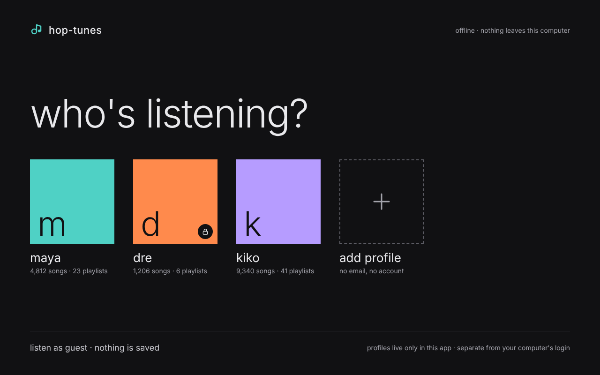
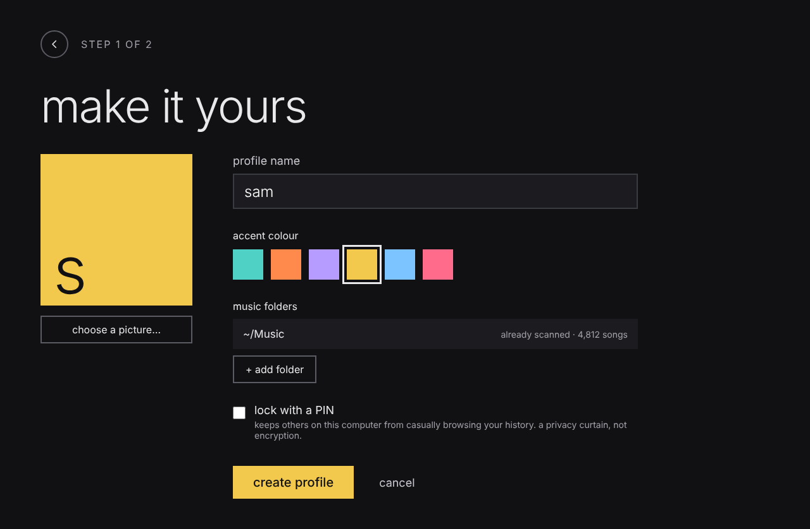
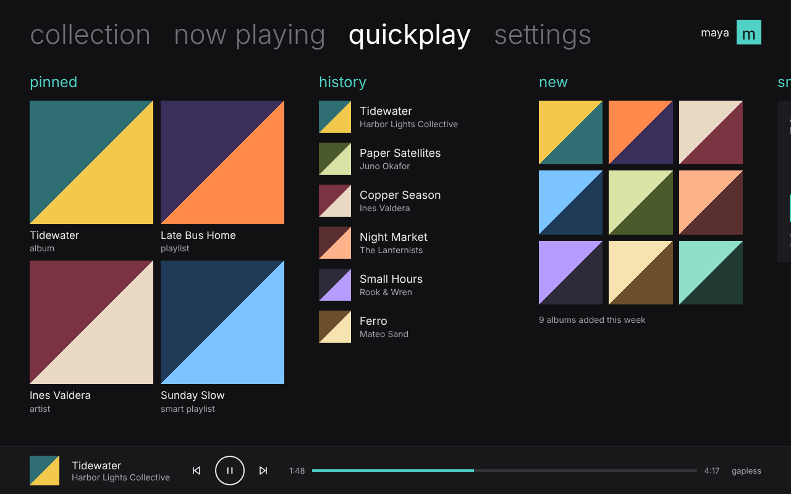
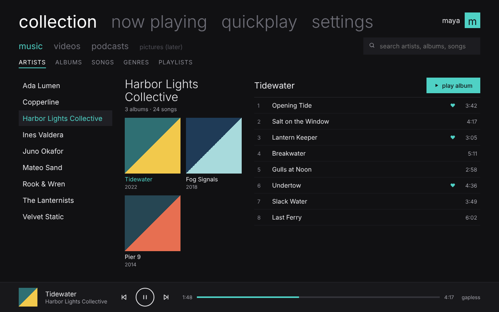
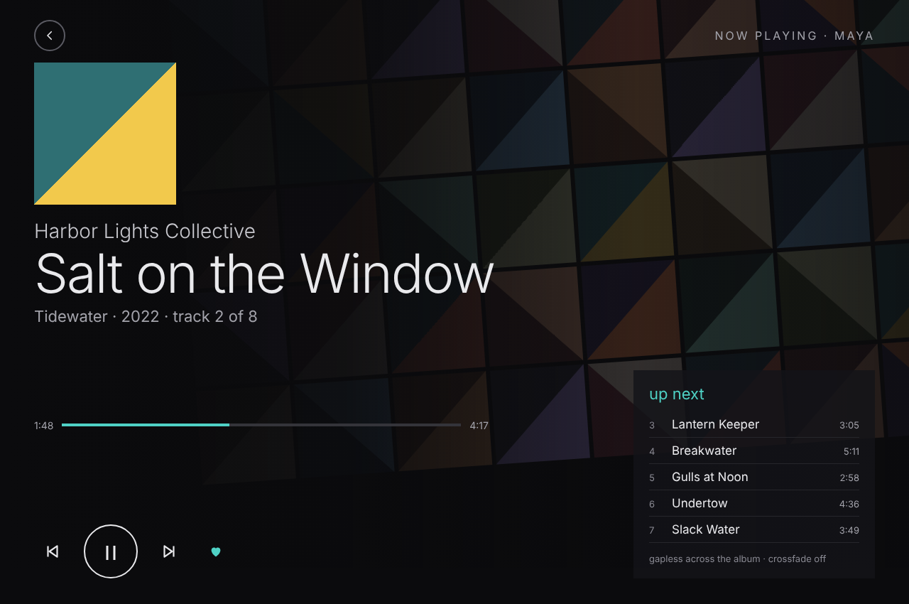

# Design mockups

Five screens showing how Hop-tunes looks and flows. They follow how the Zune desktop software was *organised* (pivots, three-pane collection, Now Playing art mosaic, Quickplay), with an original Hop-tunes look and no Microsoft assets. See [`../SPEC.md`](../SPEC.md) §3–4.

| # | Screen | Screenshot | Clickable page |
|---|---|---|---|
| 1 | Who's listening (profile picker) | [png](screens/1-whos-listening.png) | [`mockups/index.html`](mockups/index.html) |
| 2 | Create a local profile | [png](screens/2-create-profile.png) | [`mockups/create-profile.html`](mockups/create-profile.html) |
| 3 | Quickplay (start page) | [png](screens/3-quickplay.png) | [`mockups/quickplay.html`](mockups/quickplay.html) |
| 4 | Collection › music › artists | [png](screens/4-collection-music.png) | [`mockups/collection.html`](mockups/collection.html) |
| 5 | Now playing | [png](screens/5-now-playing.png) | [`mockups/now-playing.html`](mockups/now-playing.html) |

## Opening the clickable mockups

Open `mockups/index.html` in any browser; there is no build step. The pages link to each other like the real app:
- profile tiles → quickplay
- tabs at the top switch screens
- artists and albums in collection are clickable
- name and colour on the create-profile screen update live
- play/pause on now playing toggles

## Design notes
- **Type:** Jost (open font, loaded from Google Fonts), falling back to Inter or the system sans. The screenshots were rendered offline, so they show the Inter fallback.
- **Colours:** near-black ground `#111113`, text `#e9e9ec`, one accent per profile (default teal `#4fd1c5`; orange, violet, yellow, sky and rose are the other options).
- **Album art:** the two-colour tiles are placeholders. All artists, albums and songs are invented.
- **Motion:** the Now Playing mosaic drifts slowly and stops when the system's "reduce motion" setting is on.

The editable source of these mockups also lives as a design canvas in Claude ("Hop-tunes Screens").
