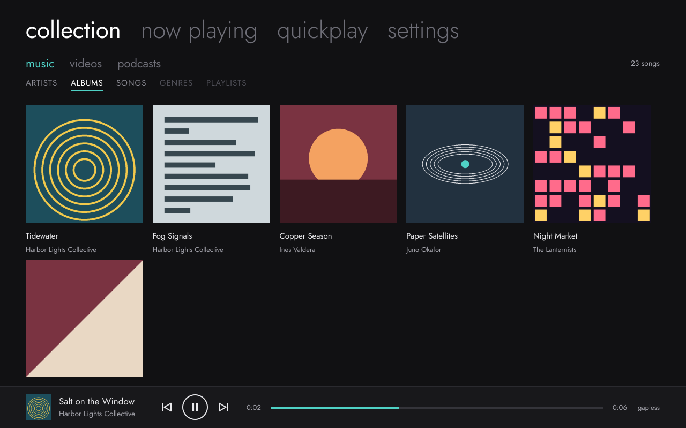
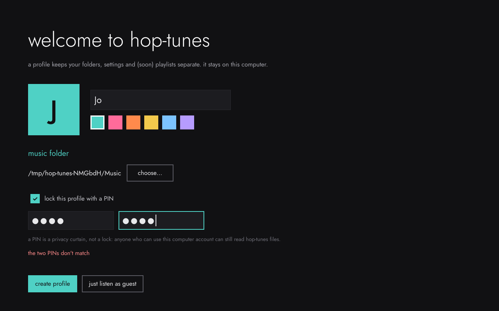
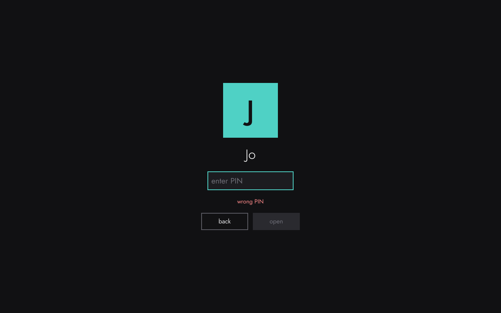
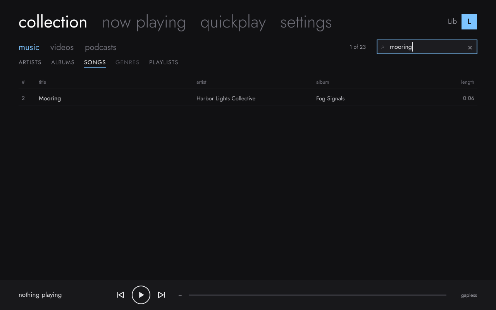

# Design mockups

**Reference only:** these are design targets for the real Qt/QML interface, not app code.

Five screens showing how Hop-tunes looks and flows. They follow how the Zune desktop software was *organised* (pivots, three-pane collection, Now Playing art mosaic, Quickplay), with an original Hop-tunes look and no Microsoft assets. See [`../SPEC.md`](../SPEC.md) §3–4.

| # | Screen | Screenshot | Clickable page |
|---|---|---|---|
| 1 | Who's listening (profile picker) | [png](screens/1-whos-listening.png) | [`mockups/index.html`](mockups/index.html) |
| 2 | Create a local profile | [png](screens/2-create-profile.png) | [`mockups/create-profile.html`](mockups/create-profile.html) |
| 3 | Quickplay (start page) | [png](screens/3-quickplay.png) | [`mockups/quickplay.html`](mockups/quickplay.html) |
| 4 | Collection › music › artists | [png](screens/4-collection-music.png) | [`mockups/collection.html`](mockups/collection.html) |
| 5 | Now playing | [png](screens/5-now-playing.png) | [`mockups/now-playing.html`](mockups/now-playing.html) |

## Opening the clickable mockups

Open `mockups/index.html` in any browser; there is no build step. The pages link to each other like the real app:
- profile tiles → quickplay
- tabs at the top switch screens
- artists and albums in collection are clickable
- name and colour on the create-profile screen update live
- play/pause on now playing toggles

## Design notes
- **Type:** Jost (open font, loaded from Google Fonts), falling back to Inter or the system sans. The screenshots were rendered offline, so they show the Inter fallback.
- **Colours:** near-black ground `#111113`, text `#e9e9ec`, one accent per profile (default teal `#4fd1c5`; orange, violet, yellow, sky and rose are the other options).
- **Album art:** the two-colour tiles are placeholders. All artists, albums and songs are invented.
- **Motion:** the Now Playing mosaic drifts slowly and stops when the system's "reduce motion" setting is on.

The editable source of these mockups also lives as a design canvas in Claude ("Hop-tunes Screens").

## The real app (renders of the running build)

Screenshots of Hop-tunes itself, rendered headless from the actual build. The sample albums and covers are invented test data.

| collection › artists | collection › albums | now playing |
|---|---|---|
|  |  |  |

M2 adds the three-pane artists view, the albums grid, real cover art (embedded or `cover.jpg`) and a Now Playing mosaic built from your own covers.

| who's listening? | first run | PIN curtain | settings › profile |
|---|---|---|---|
|  |  |  |  |

M3 adds local profiles. These renders come from the automated UI test (`HOPTUNES_UI_SHOTS=<dir> ./test_ui`), which drives the real screens: create a profile with a PIN, enter a wrong PIN, switch profiles, and change the colour and picture.

| quickplay | playlist | smart playlist rules | search | song menu |
|---|---|---|---|---|
|  |  |  |  |  |

M4 adds playlists, smart playlists, search, hearts and play counts, and the Quickplay page with pins, history, new albums and the smart DJ. These renders also come from the UI test, run against the sample library (`HOPTUNES_UI_LIBRARY=<folder>`).

| light theme | now playing | playback settings | appearance settings |
|---|---|---|---|
|  |  |  |  |

M5 adds crossfade, ReplayGain, shuffle and repeat, a volume control, light/dark/system themes, pivot transitions, drag-to-reorder and idle-fading Now Playing controls.
