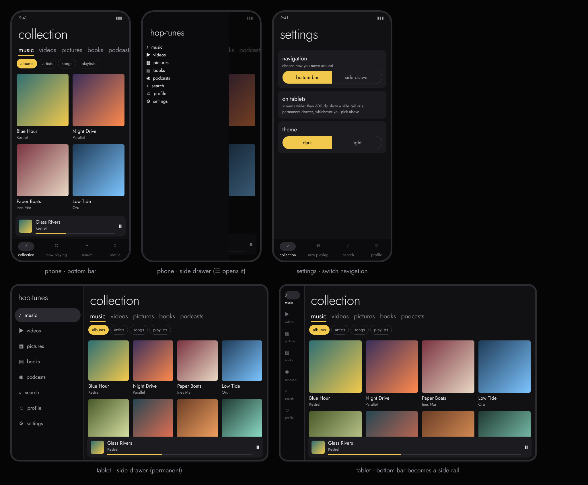

# Android UI mockup (design only, nothing is built yet)

- Same look as the desktop app: dark palette, yellow accent, Jost, lowercase labels, pivot tabs.
- **Two ways to move around, switched in settings › navigation:** a **bottom bar** (collection, now playing,
  search, profile) or a **side drawer** (music, videos, pictures, books, podcasts, search, profile, settings),
  opened with ☰ on phones.
- **Phones and tablets:** under 600 dp the bottom bar or an opening drawer is used. On wider screens the bottom
  bar becomes a side rail and the drawer becomes permanent. Grids add columns as the screen grows.
- Sub sections (albums, artists, songs, playlists; movies, shows, cartoons, anime, other) are pills under the tabs.
- A mini player sits above the bottom bar; tapping it opens full now playing.
- Party Watch is not part of the Android design for now.
