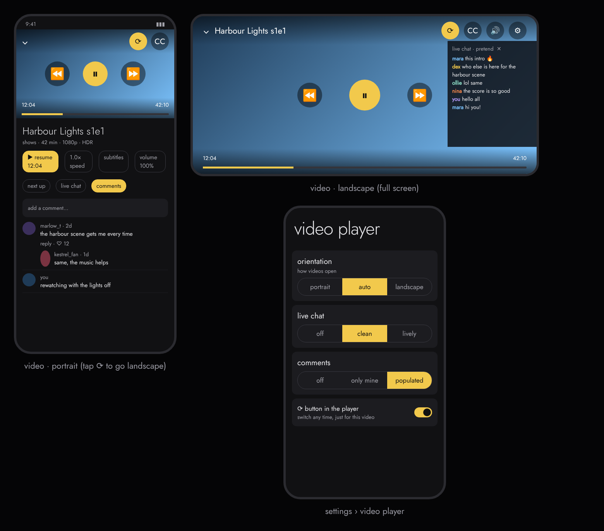
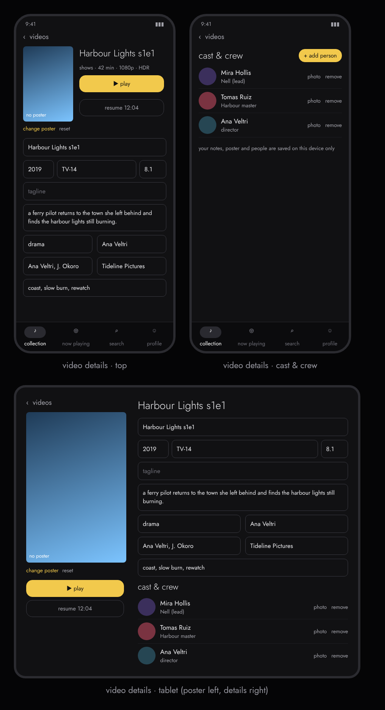

# Android UI mockup (design only, nothing is built yet)

- Same look as the desktop app: dark palette, yellow accent, Jost, lowercase labels, pivot tabs.
- **Two ways to move around, switched in settings › navigation:** a **bottom bar** (collection, now playing,
  search, profile) or a **side drawer** (music, videos, pictures, books, podcasts, search, profile, settings),
  opened with ☰ on phones.
- **Phones and tablets:** under 600 dp the bottom bar or an opening drawer is used. On wider screens the bottom
  bar becomes a side rail and the drawer becomes permanent. Grids add columns as the screen grows.
- Sub sections (albums, artists, songs, playlists; movies, shows, cartoons, anime, other) are pills under the tabs.
- A mini player sits above the bottom bar; tapping it opens full now playing.
- Party Watch is not part of the Android design for now.

## Video player: portrait and landscape

- **Portrait:** the video sits at the top in 16:9, with the title, resume, speed, subtitles, volume (0 to 150 %)
  and "next up" below it.
- **Landscape:** the video fills the screen, with the same controls laid over it.
- **Switching:** the ⟳ button in the player toggles between the two at any time, just for that video.
  Settings › video player sets how videos open: portrait, auto (follows the phone) or landscape.
- **Pretend live chat and comments:** in portrait they sit under the video as tabs (next up, live chat,
  comments), with made-up commenters, replies and your own comments. In landscape a slim live chat slides in
  from the right edge and can be closed; comments are not shown there. Settings › video player has the same
  choices as the desktop: live chat off / clean / lively, comments off / only mine / populated. Nobody in
  either is real; it is all generated on the device.

## Video details page

Same fields as the desktop page: poster (change / reset), title, year, rating, score, tagline, overview,
genre, director, writers, studio, tags, and cast & crew (add person, role, photo, remove). On a phone it is
one scrolling column with play and resume next to the poster; on a tablet the poster and play buttons sit on
the left and the details on the right. Everything stays on the device.
